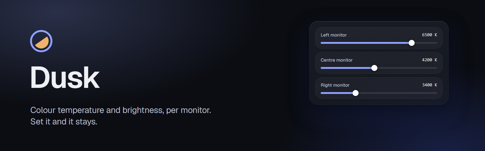

# Dusk

Colour temperature and brightness for Windows, set per monitor. You choose a value and it stays there.

Dusk has no schedule, no location lookup and no network access. It is a tray icon, a small panel and a handful of hotkeys.

## What it does

- One temperature slider (1200 to 9000 K) and one brightness slider (10 to 100 %) for each monitor
- Values are remembered per physical monitor, so different panels can get different settings
- Three presets per monitor: press Save, then 1, 2 or 3 to store the current values
- A blue light filter button per monitor, with its own stored temperature (3400 K by default)
- A note beside each monitor name: double-click to label a screen
- A short on-screen readout on the affected monitor after each hotkey

## Hotkeys

Hotkeys act on the monitor under the mouse. Add Shift to change all monitors.

| Keys | Action |
| --- | --- |
| `Ctrl+Alt+Up` / `Ctrl+Alt+Down` | Brightness up / down |
| `Ctrl+Alt+Right` / `Ctrl+Alt+Left` | Cooler / warmer |
| `Ctrl+Alt+Home` | Everything on or off |

Keys and step sizes can be changed in `%APPDATA%\Dusk\settings.json`.

## Build

Requires the .NET 8 SDK on Windows.

```
dotnet publish -c Release -r win-x64 -p:SelfContained=false -p:PublishSingleFile=true -p:DebugType=none -o dist
```

The result is a single `dist\Dusk.exe` that needs the .NET 8 Desktop Runtime.

## Notes

- Brightness is software dimming through the display gamma ramp. It darkens the picture, not the backlight.
- Windows limits how far a gamma ramp may move from neutral. Very warm or very dim values need the registry value `GdiICMGammaRange` (DWORD 256) under `HKLM\SOFTWARE\Microsoft\Windows NT\CurrentVersion\ICM`, followed by a restart.
- Other tools that set gamma ramps will fight with Dusk. Run one at a time.

## License

MIT
