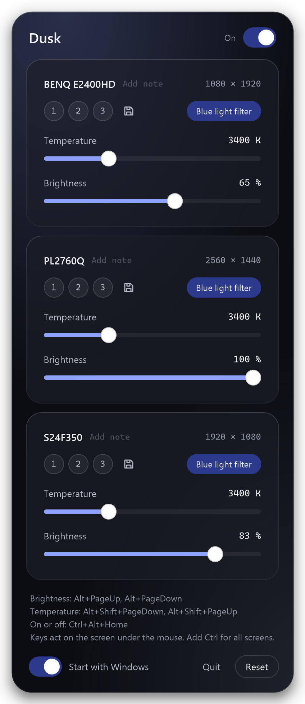

<p align="center">
  
</p>

<h1 align="center">Dusk</h1>

<p align="center">
  <b>Colour temperature and brightness for Windows, per monitor.</b>
</p>

<p align="center">
  <a href="https://github.com/314159DD/dusk/releases/latest"></a>
  
  
  
  
  
  <a href="LICENSE"></a>
</p>

<p align="center">
  <a href="https://github.com/314159DD/dusk/releases/latest"></a>
</p>

---

Different monitors rarely look the same at the same setting, so a multi-monitor desk often needs an individual brightness and colour temperature for each screen. Dusk lets you set every monitor on its own, by hotkey, and keeps it there. It has no schedule, no location lookup and no account.

<p align="center">
  
</p>

## Features

- **Per monitor.** One temperature and one brightness slider for every screen, remembered per physical display.
- **Hotkeys first.** Change the screen under your mouse without opening anything.
- **Three presets per screen.** Press the disk, pick 1, 2 or 3.
- **Blue light filter.** One click per screen, with its own stored temperature.
- **Quiet readout.** A small popup in the top right corner of the changed screen shows the new values for a second, then goes away.
- **Notes.** Click beside a monitor name to label it.
- **Your order.** Drag a screen by its grip to rearrange the list.
- **Tiny.** One native exe, about 2 MB of memory while idle, nothing to install, zero network calls.

## Hotkeys

| Keys | Action |
| --- | --- |
| `Alt` `PageUp` / `PageDown` | Brighter / darker |
| `Alt` `Shift` `PageUp` / `PageDown` | Cooler / warmer |
| add `Ctrl` | Apply to all screens |
| `Ctrl` `Alt` `Home` | Everything on or off |

Hotkeys act on the screen under the mouse.

## Install

1. Download `Dusk.exe` from [Releases](https://github.com/314159DD/dusk/releases/latest).
2. Run it. It lives in the tray.
3. Optional: switch on **Start with Windows** in the panel.

Quit other screen tint tools first, they overwrite each other.

<details>
<summary><b>Build from source</b></summary>

Needs the Visual Studio C++ build tools and a Windows SDK.

```
build.bat
```

The result is `dist\Dusk.exe`.
</details>

<details>
<summary><b>Good to know</b></summary>

- Brightness is software dimming. It darkens the picture, not the backlight.
- Very warm or very dim values need the registry value `GdiICMGammaRange` (DWORD 256) under `HKLM\SOFTWARE\Microsoft\Windows NT\CurrentVersion\ICM`, then a restart.
- Keys and step sizes live in `%APPDATA%\Dusk\settings.json`.
</details>

---

<p align="center">MIT licensed.</p>
